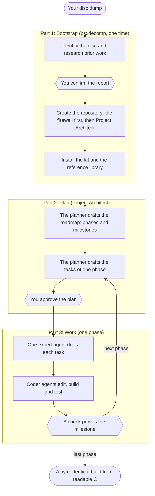

<p align="center">
  <picture>
    <source media="(prefers-color-scheme: dark)" srcset="docs/assets/psxdecomp-banner-dark.svg">
    
  </picture>
</p>

# PSXDecomp: PS1 decompilation bootstrapper for Claude Code

**A Claude Code plugin that bootstraps PlayStation 1 (PS1/PSX) matching decompilations.** Starting from an empty folder and a
disc dump you own, it identifies the game, researches prior work, pins a library of SDK and tooling references, and
installs [Project Architect](https://github.com/Druthulu/ProjectArchitect) with the decomp-architect kit. The result
is a repository ready for its first planning phase, and it keeps working without the plugin.

<!-- psxdecomp: ai-policy -->
> [!IMPORTANT]
> **AI policy:** LLMs produce negligible decompilation results without good guidance. Investigate and familiarize yourself with the console's architecture and the game you are decompiling, and always use your own judgment. Humans drive the decisions. AI reads and writes the code.

PlayStation 1 only, at version 0.6.0. Other consoles are planned as profiles ([docs/PROFILES.md](docs/PROFILES.md)).

## Games

Each backtest replays a real bootstrap with its community leads blanked; the research stage has to find them again.

| Game | Serial | Bootstrap |
|---|---|---|
| Mega Man X6 | SLUS-01395 (v1.1) | mmx6, 2026-10-01 |
| Mega Man X5 | SLUS-01334 | mmx5, 2026-10-03 |
| Dino Crisis 2 | SLUS-01279 | the DC2 branch, 2026-09-30 |
| Brave Fencer Musashi | SLUS-00726 | [BFM-decomp](https://github.com/Druthulu/BFM-decomp), the kit's home project (2026-10-01) |

## What it does

- **Identification.** The disc is read in place: boot executable, track layout, PsyQ library stamps. Only facts are
  recorded, and no byte of the dump is copied.
- **Research.** Parallel agents look for existing decompilations (decomp.dev's listing first), sibling games and their
  toolchains, symbol maps, ports and releases. Findings stay leads until a later phase verifies them, and nothing is
  installed before you confirm the report.
- **Repository.** The ROM firewall is the first commit, after its negative control. Project Architect and the kit
  follow, each at a pinned version checked by hash ([compat.toml](compat.toml)).
- **Reference library.** Core upstream sources (splat, maspsx, old-gcc, ghidra_psx_ldr) are cloned at their pins into
  `refs/`, which git ignores and agents can still search, with a committed index by licence class.
- **Handoff.** A health check and a bootstrap record. The next session opens on Project Architect's planner.

## Workflow

A matching decompilation has three parts. psxdecomp does part 1 one time. Project Architect and the kit do parts 2
and 3 in the game repository, one phase after the other.



The six-sided boxes are the gates. Agents stop there and continue only after your decision or a passed check.

The roadmap of each game is its own, but it follows the kit's ladder of eleven phases. A game numbers them `1.0` to
`1.10` ([the numbering](profiles/psx/floor.md#numbering)). psxdecomp checks that the plan keeps every phase.

1. **Foundation (1.0 to 1.3).** Prove the firewall. Extract the disc with one command. Find the load addresses.
   Split the binaries into assembly and make the build byte-identical.
2. **Compiler (1.4).** Find the one compiler and assembler that give the same bytes for a small set of functions.
3. **Instruments (1.5 to 1.7).** Count the functions. Build the tools that find duplicates, share types and explain
   compiler output.
4. **Campaign (1.8).** Agents write C for the functions in groups. A function stays in the build only if the bytes
   are the same.
5. **Publication (1.9).** Prove the build from a fresh clone. Publish the progress report.
6. **Readability (1.10).** Remove what matching left behind: forced registers, raw offsets, names with no evidence.

A matched function is not a finished one. From the first C file, psxdecomp counts what each file still needs
([the floor](profiles/psx/floor.md)). You make the decisions and you push the commits. The agents do the work
between the gates.

## Getting started

### Requirements

Git, Python ≥ 3.12, Claude Code, and your own dump of the game as a Redump CUE/BIN, kept outside the project folder.
Project Architect is installed once per machine; the first run prints the command. `gh` is optional: research uses it
for repository facts, and the doctor for the GitHub check. Docker is needed from the first build phase, not to
bootstrap.

**macOS**

```sh
brew install git python@3.14 gh
brew install --cask claude-code docker-desktop
```

**Linux** (Ubuntu 24.04+ or Debian 13+; on Windows, WSL 2)

```sh
sudo apt install git python3 python3-venv docker.io
curl -fsSL https://claude.ai/install.sh | bash
```

`gh` comes from [GitHub's apt repository](https://github.com/cli/cli/blob/trunk/docs/install_linux.md) or
`brew install gh`: the distributions' own package is broken. Older releases, Homebrew on Linux and WSL are covered in
the [Linux host recipe](profiles/psx/hosts/linux-amd64.md); each game repository receives its machine's recipe, with
the build and debugging tools, as `docs/ops/host-recipe.md`.

### Install the plugin

```
/plugin install psxdecomp --marketplace anzaldoivan/psxdecomp
```

That one line needs Claude Code 2.1.275 or later. On an older one, run `/plugin marketplace add anzaldoivan/psxdecomp`
and then `/plugin install psxdecomp`.

### Bootstrap a game

| Session | Command | Stages |
|---|---|---|
| 1 | `/psxdecomp:new` in an empty folder | interview, identification, research, your confirmation, repository, Project Architect |
| 2 | `claude --agent plain`, then `/psxdecomp:new --resume` | intake, kit, reference library, handoff |
| 3 | `claude` | Project Architect's planner drafts the roadmap |

The restart between sessions 1 and 2 loads Project Architect's hooks; when session 2 opens, psxdecomp's own hook
prints the resume line. A bare `claude` opens Project Architect's router (`agent: pa-session` in
`.claude/settings.json`); `claude --agent plain` is the way around it. `--answers FILE` replaces the interview with a
prepared file; `--deep` widens the research.

### Other commands

| Command | Purpose |
|---|---|
| `/psxdecomp:doctor` | Read-only health check: pins, firewall, reference library, documentation hygiene, the README standard. It checks the roadmap against the ladder, and each tool of the floor when its phase makes it due. It also lints a decomp.dev progress workflow and the GitHub security settings, and names the fix for each finding. |
| `/psxdecomp:upgrade` | Adopts a repository that was set up by hand. |

## What a game repository contains

```
your-game/
  README.md               the project's front page, on the README standard, with the AI policy
  config/discs.tsv        the disc, serial and executable rows the README's disc table shows
  tools/psxd_publish.py   the README lint and the decomp.dev report checks, run by the game's CI
  tools/psxd_floor.py     the roadmap lint, the readability debt count and the guard hook
  docs/ops/psxdecomp-floor.md  what to do after the bootstrap, the phase numbering, every check of the floor
  config/debt-baseline.txt     the readability debt of each source file (a matched file is not a finished one)
  config/guard.tsv        what an agent session may not edit or run here
  config/public-paths.txt optional, split mode: the paths the public repo shows ([docs/PUBLISHING.md](docs/PUBLISHING.md#split-mode-a-public-trunk-a-private-workspace-a-private-store))
  config/psxdecomp.toml   the bootstrap record: pins, profile, PsyQ lead
  docs/prior-art.md       the research report you confirmed
  docs/ops/refs.md        the reference-library index (the sources sit in the ignored refs/)
  docs/ops/host-recipe.md the tools for this machine, with install commands
  .ignore                 keeps refs/ searchable for agents although git ignores it
  HOW_WE_WORK.md          Project Architect's working card for agents
  tools/audit_public.py   the ROM firewall, enforced from the first commit
```

## No game data

No game byte, SDK file or disc image enters a repository, its CI or the tests. The dump is read where it sits; the
PsyQ SDK is bring-your-own and never fetched; the tests run on a synthetic disc built at test time; and
`tools/audit_public.py` rejects disc images, executables and SDK paths on every push.

## Learn more

| Read | For |
|---|---|
| [docs/ARCHITECTURE.md](docs/ARCHITECTURE.md) | the design, its reasons, and the test tiers |
| [skills/new/reference/stages.md](skills/new/reference/stages.md) | each stage: what it reads, writes and records |
| [compat.toml](compat.toml) and [docs/ECOSYSTEM.md](docs/ECOSYSTEM.md) | the pinned versions and the upstreams watched |
| [docs/REFS.md](docs/REFS.md) | the reference library |
| [docs/PUBLISHING.md](docs/PUBLISHING.md) | the README standard and publishing progress to decomp.dev |
| [docs/PROFILES.md](docs/PROFILES.md) | console profiles and the consoles planned next |
| [CONTRIBUTING.md](CONTRIBUTING.md) | tests, releases and pin bumps |

## Thanks

psxdecomp builds on:

- [Project Architect](https://github.com/Druthulu/ProjectArchitect) and the decomp-architect kit from
  [`BFM-decomp`](https://github.com/Druthulu/BFM-decomp), installed unchanged.
- [psxrecomp](https://github.com/RetroPortingToolKit/psxrecomp), whose single-manifest pinning and README shape
  inspired this one. psxdecomp is not affiliated with it and takes ideas only, no code or text: its PolyForm
  Noncommercial licence is incompatible with this repository's.
- The tools and references a new repository starts from: [splat](https://github.com/ethteck/splat),
  [maspsx](https://github.com/mkst/maspsx), [spimdisasm](https://github.com/Decompollaborate/spimdisasm),
  [old-gcc](https://github.com/decompals/old-gcc), [ghidra_psx_ldr](https://github.com/lab313ru/ghidra_psx_ldr),
  [psy-q-decomp](https://github.com/sozud/psy-q-decomp), [sotn-decomp](https://github.com/Xeeynamo/sotn-decomp),
  [PCSX-Redux](https://github.com/grumpycoders/pcsx-redux), [psx-spx](https://github.com/psx-spx/psx-spx.github.io),
  [decomp.me](https://decomp.me), [decomp.dev](https://decomp.dev) and [Redump](http://redump.org/).

- Three projects whose practice shaped the roadmap and readability checks of version 0.6.0. psxdecomp took ideas
  and wrote each file fresh:
  - [parasite-eve-decomp](https://github.com/khasinski/parasite-eve-decomp) by khasinski. A debt baseline that must
    equal the tree, and one `verify` gate. An evidence record for each assembly function. A pinned toolchain that
    refuses a patched checkout. A definition of a finished file, apart from a matched one.
  - [kings-field-decomp](https://github.com/sushi-shi/kings-field-decomp) and its sibling projects by sushi-shi. The
    naming ledger with evidence and a decision. The bank ledger, the two budgets and the triage order.
  - [snowboardkids2-decomp](https://github.com/cdlewis/snowboardkids2-decomp) by cdlewis: hooks that refuse an edit
    of assembly and hash files, and a fixed report when an agent gives up on a function.

[docs/ECOSYSTEM.md](docs/ECOSYSTEM.md) records the commit each was checked at.

## Licence

MIT ([LICENSE](LICENSE)). The fixture program and the banner are CC0; the banner's wordmark is drawn from Exo 2
(SIL Open Font License 1.1, [docs/assets](docs/assets/README.md)). Nothing here is derived from any game.
